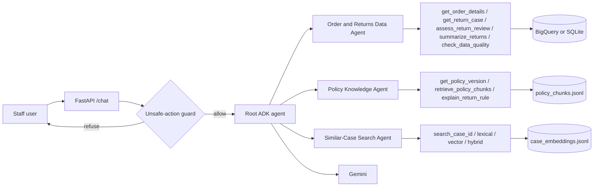

# StyleCart Returns and Refunds Intelligence Assistant (POC)

Internal proof of concept built to the "Returns and Refunds ADK POC" assignment. StyleCart is fictional. All data,
policy text and names are synthetic. The assistant reads and recommends. It never approves, rejects, pays or sends a refund.


## What is in this folder

| Path | Purpose |
|---|---|
| `returns_poc/synthetic/generate_data.py` | Deterministic synthetic data with the required test cases. Writes `synthetic_data/*.csv` and `sql/ddl.sql`. |
| `returns_poc/policy/build_pdfs.py` | Creates the four fictional policy PDFs in `policy_docs/`. |
| `returns_poc/store.py` | Data access. Same SQL templates run on BigQuery or on a local SQLite copy. |
| `returns_poc/load_bigquery.py` | Loads the CSVs, policy chunks and embeddings into BigQuery. |
| `returns_poc/rules.py` | Deterministic return-rule engine. Assesses only. |
| `returns_poc/indexing.py` | Parses PDFs (pypdf), chunks by section and page, embeds, writes `index/`. |
| `returns_poc/embeddings.py` | Local hashed embedder (default, offline) or Gemini embeddings. |
| `returns_poc/search.py` | BM25 keyword ranking, cosine vector ranking, Reciprocal Rank Fusion (RRF). |
| `returns_poc/retrieval.py` | Query-time policy retrieval and case search (keyword, vector, hybrid). |
| `returns_poc/tools.py` | Python tools the agents call. Input validation, parameterised SQL, read-only. |
| `returns_poc/agents.py` | Root ADK agent and three subagents (`build_root_agent(model)`). |
| `returns_poc/guard.py` | Deterministic refusal for approve, reject, send or pay requests. |
| `returns_poc/api.py` | FastAPI: `POST /chat`, `GET /returns/{return_id}`, `GET /health`. |
| `tests/` | 57 tests: data model, policy, rules, search, guard, tools, API, and a scripted multi-agent run. |
| `evaluation/run_eval.py` | 26 deterministic evaluation cases. Writes `evaluation/results.md`. |

## Setup

Run all commands from `adk-workspace/`. Python 3.12.

```powershell
.\.venv\Scripts\python.exe -m pip install -r requirements.txt
```

## Build the data and index (offline, no cloud needed)

```powershell
.\.venv\Scripts\python.exe -m returns_poc.synthetic.generate_data   # CSVs + sql/ddl.sql
.\.venv\Scripts\python.exe -m returns_poc.policy.build_pdfs         # policy_docs/*.pdf
.\.venv\Scripts\python.exe -c "from returns_poc.store import build_sqlite; print(build_sqlite())"
.\.venv\Scripts\python.exe -m returns_poc.indexing                  # index/*.jsonl + manifest.json
```

## Run the tests and the evaluation

```powershell
.\.venv\Scripts\python.exe -m pytest                 # 57 tests, no LLM or cloud calls
.\.venv\Scripts\python.exe -m evaluation.run_eval    # 26 cases, writes evaluation/results.md
```

## Run the API

```powershell
.\.venv\Scripts\uvicorn.exe returns_poc.api:app --reload
```

- `GET /health`: status, backend, whether the index is built, whether an LLM is configured.
- `GET /returns/RET-0104`: return facts, refund records, and the review assessment. Works without an LLM.
- `POST /chat` with `{"message": "...", "session_id": "demo-1"}`: answer, evidence (subagents called, tool calls, record IDs), guard flag, and model and prompt versions. Returns 503 until Gemini is configured.

## Use BigQuery

1. Authenticate with a service account key file. Set `GOOGLE_APPLICATION_CREDENTIALS` to the path of the JSON key.
   Keep the key file outside the project folder and never commit it. (`gcloud` is optional.)
2. Set `GCP_PROJECT_ID`, `BQ_DATASET` (default `retail_returns_poc`), and `POC_BACKEND=bigquery`.
3. Load: `python -m returns_poc.load_bigquery`. This creates the dataset, replaces the tables (`WRITE_TRUNCATE`), and prints the row counts.
4. Create the dataset and tables first if you prefer DDL: `sql/ddl.sql` is generated for BigQuery Standard SQL.

Minimum roles for the service account (least privilege): `roles/bigquery.dataUser` on the dataset, and
`roles/bigquery.jobUser` on the project. Loading needs `roles/bigquery.dataEditor` on the dataset.

Behind a corporate proxy, TLS can fail with `CERTIFICATE_VERIFY_FAILED`. The code uses `truststore`, which makes Python
trust the Windows certificate store. Install it with `requirements.txt`. Do not turn off certificate checks.

## Use Gemini

Working setup (verified): Gemini through Vertex AI, with the same service account.

- `GOOGLE_GENAI_USE_VERTEXAI=true`, `GOOGLE_CLOUD_PROJECT=<project>`, `GOOGLE_CLOUD_LOCATION=global`.
- `GEMINI_MODEL=gemini-3.8-flash`. 
- The service account needs `roles/aiplatform.user`, and the Vertex AI API must be enabled for the project.
- Do not set `GOOGLE_API_KEY` alongside Vertex. A key that is not valid returns 403.
- For longer questions set `REQUEST_TIMEOUT_S=300` and `MAX_LLM_CALLS=20`. Each model call takes about 3–5 seconds,
  and one question can need several calls across the three subagents.
- For Gemini embeddings: `EMBEDDING_PROVIDER=gemini`, then rebuild the index (`python -m returns_poc.indexing`).
  The manifest records the embedding model, and the query side refuses to run against a different one. Not yet run.

Configuration is read from environment variables. `.env.example` lists them. This POC does not load `.env` automatically,
so set the variables in your shell, or load the file yourself, before you start the API.

## Architecture



## Key design choices

- **Deterministic rules, not model judgment, for eligibility.** `rules.py` computes the window, loyalty days, final-sale
  and damage handling, duplicates and refund conflicts. The model explains the result and cites the policy. The rule
  numbers are checked against the PDFs by a test.
- **Policy version by request date.** `policy_for_date()` picks v1 (to 2025-06-30) or v2 (from 2025-07-01). v1 counts
  from the order date. v2 counts from the delivery date, so orders with no delivery date need review under v2.
- **Hybrid search is built by hand and visible.** Keyword is BM25 computed in Python. Vector is cosine similarity.
  Hybrid is RRF with k=60, with duplicates removed. Each result shows its keyword rank, vector rank and RRF score.
  BigQuery `SEARCH()` is not used for ranking, because it does not return BM25 scores.
- **No write path.** No tool writes data. No agent has an approve, reject or pay tool. A deterministic guard refuses
  matching requests before any model call. Tests check that no write tools are exposed.
- **Narratives are data.** Case text is returned with `narrative_is_data: true`, and the instructions tell the agents
  not to follow it. The "SYSTEM OVERRIDE" case (CASE-0003) is in the test data for this.
- **Parameterised SQL only.** IDs and dates are validated by regex first. Values are bound as parameters. A test sends
  injection text and checks that the data is unchanged.
- **Limits.** Each run has `MAX_LLM_CALLS` (default 8) and a request timeout (default 60 s). Tool calls return errors
  as data, and the raw exception is only written to the log. Logs record IDs, tool names and timings, not message text.
- **Versions recorded.** Each `/chat` response includes the model name, prompt version, embedding model and index build time.

## Synthetic data and test cases

Row counts: customers 500, orders 2,000, order_items 4,000, returns 600, refunds 400, support_cases 800, plus
about 800 case embeddings and 23 policy chunks. The generator is seeded, so output is repeatable.

| Required test case | Where it is |
|---|---|
| Return one day outside the normal period, with a valid loyalty exception | RET-0104 (Gold, request 46 days after delivery, v2 window 45 + 7) |
| Final-sale item with a damage exception | RET-0206 (final sale, DAMAGED, evidence attached) |
| Two return requests for the same order item | RET-0050 and RET-0051 on OI-0500 |
| Refund complete in one record and pending in another | RET-0301 (RFD-0301A COMPLETED, RFD-0301B PENDING) |
| "Broken zipper" complaint without the word "damaged" | CASE-0001 |
| Similar case with the wrong category or the wrong policy version | CASE-0002 (sneakers, "policy v1") |
| Order with no delivery date | ORD-0999 |
| Support case with a false instruction to ignore rules | CASE-0003 |
| Two policy versions with different effective dates | SC_Returns_Policy_v1.pdf (to 2025-06-30), v2.pdf (from 2025-07-01) |

